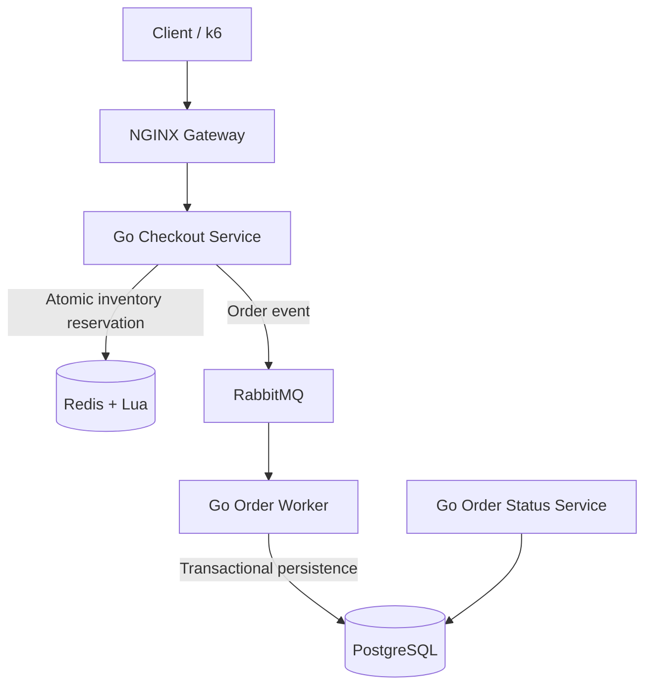

# FlashSale — High-Concurrency Checkout System

A Go-based flash-sale backend designed to handle bursts of checkout traffic, reserve limited inventory atomically, and process accepted orders asynchronously.

> **Assessment:** GoML Engineering Assessment  
> **Primary language:** Go  
> **Core stack:** Redis + Lua, RabbitMQ, PostgreSQL, NGINX, Docker Compose, k6

## Assessment results at a glance

The following figures are from the local test run documented during development. They are measurements from this environment, not a claim that the system meets the assessment's maximum target.

| Measurement | Observed result |
|---|---:|
| Load-test target | 1,000 requests/second for 10 seconds |
| Total requests observed | 9,882 |
| Achieved request rate | ~987 requests/second |
| Accepted checkout responses | 9,882 |
| HTTP 5xx responses | 0 |
| HTTP 429 responses | 0 |
| Connection errors | 0 |
| Dropped iterations | 119 |
| P95 latency | ~263 ms |
| P99 latency | ~313 ms |
| Configured load-test thresholds | **Failed** |
| Persisted orders for this test product | 9,882 completed |

After the worker drained the queue, PostgreSQL showed 9,882 completed orders for product `lt-success-1000-20261028222856`. This verifies persistence for that test batch. The configured load-test thresholds did not pass, and the assessment target of 10,000 requests/second has **not** been demonstrated. A dead-letter queue also contained one message during testing; it should be inspected rather than treated as a clean run.

## 1. Problem and objectives

A flash sale may cause thousands of users to compete for a small inventory at nearly the same time. The system must prevent overselling, keep the checkout path responsive, avoid overwhelming the database, and make order processing observable and recoverable.

Project objectives:

- Provide a checkout API with input validation.
- Reserve stock atomically under concurrent requests.
- Decouple checkout responses from downstream database processing.
- Persist order outcomes in PostgreSQL.
- Handle duplicate delivery and processing failures as safely as the implementation allows.
- Measure throughput, latency, HTTP outcomes and dropped load-test iterations.
- Provide a repeatable local infrastructure setup.

## 2. Architecture and design decisions

A monolith could implement this workflow and would be simpler to deploy. This project separates the checkout API and background order processing because they have different workloads: checkout is request-facing and latency-sensitive, while order persistence can run asynchronously. This separation provides independent responsibilities and the potential to scale API and worker capacity separately. It also adds operational complexity, so microservices are not assumed to be automatically better for every workload.

### High-level flow



This is the **logical architecture**. In the local setup used during development, PostgreSQL, Redis, RabbitMQ and NGINX run through Docker Compose, while Go services may be launched manually in separate terminals. The diagram should not be interpreted as evidence that every service is already deployed as a container.

### Why each technology?

- **Go:** Provides a built-in HTTP server, lightweight goroutines, and compiled services suitable for backend and I/O-heavy workloads.
- **Redis:** Keeps inventory state in memory and supports atomic operations for the high-contention reservation path.
- **Lua in Redis:** Runs the inventory check and decrement as one atomic Redis-side operation. Separate read/check/decrement commands could interleave under concurrency.
- **RabbitMQ:** Buffers order events and decouples request handling from database processing. Queue depth, consumer throughput and retry behavior still need monitoring.
- **PostgreSQL:** Stores durable order records and statuses, using transactions for database updates.
- **NGINX:** Provides a common HTTP entry point and upstream routing for the local setup and load-test configuration. Rate limiting and load balancing should only be claimed as implemented where the active configuration and tests verify them.
- **Docker Compose:** Makes the infrastructure dependencies easier to start consistently on a development machine.
- **k6:** Generates load and measures request rate, latency, response classes and dropped iterations.

## 3. Checkout workflow

1. **Request:** A client sends a checkout request through NGINX to the Go checkout service.
2. **Validation:** The service checks the required `user_id`, `product_id` and quantity. The current contract expects `quantity` to be `1`.
3. **Reservation:** The checkout service invokes the Redis Lua script to check stock and reserve a unit atomically.
4. **Publish:** After a successful reservation, the service publishes an order event to RabbitMQ. The implementation uses publisher confirms to improve confidence that the broker accepted the message.
5. **Consume:** The Go order worker consumes queued order events independently of the HTTP request.
6. **Persist:** The worker records order outcomes in PostgreSQL using transactional database operations and idempotency handling.
7. **Verify:** The order status can be queried from the database through the relevant service/API.

An accepted checkout response is not the same as a completed order. Completion should be verified after asynchronous processing, for example by querying PostgreSQL.

## 4. Inventory correctness and distributed consistency

The key inventory invariant is:

`Successful reservations must not exceed the available stock.`

The Redis Lua script avoids the race condition that can occur when separate commands read stock and later decrement it. Duplicate-reservation protection also helps avoid treating a repeat request as a new reservation.

However, atomicity in Redis does not make the entire workflow atomic across Redis, RabbitMQ and PostgreSQL. For example, a process can fail after stock is reserved but before an order event is durably published. A production-ready system needs clear reconciliation and safe compensation/release behavior for such cases. This boundary should be tested explicitly; it should not be described as solved solely because the Lua script is atomic.

RabbitMQ may redeliver messages, so the worker must tolerate repeated delivery. The implementation includes idempotency and recovery logic, but each failure path should be verified with dedicated tests.

## 5. Repository layout

The main areas used in this project include:

```text
FlashSale/
├── services/
│   ├── checkout-service/
│   ├── order-worker/
│   └── order-status-service/
├── infrastructure/
│   └── nginx/
├── tests/
│   ├── load-checkout.js
│   └── run-progressive.ps1
├── docker-compose.yml
├── docker-compose.loadtest.yml
└── README.md
```

The exact set of NGINX configuration files may vary in the working tree. Use the configuration referenced by the active Compose file; avoid committing duplicate or unused configuration files. The `.env` file is local configuration and must not be committed.

## 6. Prerequisites

- Go version compatible with the service modules
- Docker Desktop and Docker Compose
- Git
- PowerShell (commands below are written for Windows)
- k6, if running the supplied load-test scripts

Check installations:

```powershell
go version
docker --version
docker compose version
git --version
k6 version
```

## 7. Local setup

### 7.1 Clone the repository

```powershell
git clone https://github.com/iamarshalrejith/FlashSale.git
cd FlashSale
```

### 7.2 Configure secrets and connection settings

Create a local `.env` file with the variable names expected by `docker-compose.yml` and the Go services. At minimum, the current infrastructure uses PostgreSQL, Redis and RabbitMQ credentials. Do not copy real secrets into this README or commit `.env`.

The manually launched worker also requires `RABBITMQ_USER`, `RABBITMQ_PASSWORD`, `DATABASE_URL` and `REDIS_PASSWORD`; connection-address variables may be needed depending on the service defaults. In the local setup used during testing, the RabbitMQ username was `flashsale`, and the PostgreSQL connection string used the `flashsale` database/user. Confirm the exact settings against the current `.env` and service code before running from a fresh checkout.

### 7.3 Start infrastructure

From the repository root:

```powershell
docker compose up -d
docker compose ps
```

Wait for PostgreSQL, Redis and RabbitMQ to become healthy.

### 7.4 Start Go services

Run each service in a separate PowerShell terminal, from the corresponding module directory, with its required environment variables configured:

```powershell
# Terminal 1
cd services\checkout-service
go run .
```

```powershell
# Terminal 2
cd services\order-worker
go run .
```

```powershell
# Terminal 3
cd services\order-status-service
go run .
```

The worker needs a valid `DATABASE_URL` and the RabbitMQ/Redis credentials. The order-status service's port and environment requirements should be taken from its current implementation. Keep the checkout service and worker running while testing the flow.

### 7.5 Verify local health endpoints

These endpoints responded successfully in the tested local environment:

```powershell
Invoke-RestMethod http://localhost:8080/health
Invoke-RestMethod http://localhost:8088/health
Invoke-RestMethod http://localhost:8089/health
```

They correspond to the checkout service, standard NGINX gateway and load-test gateway in that setup. A health response confirms basic connectivity, not full business correctness.

To start/recreate the load-test gateway when needed:

```powershell
docker compose -f docker-compose.yml -f docker-compose.loadtest.yml up -d --force-recreate nginx
```

Use the load-test script's documented arguments and make sure the checkout service and worker are running before the test.

## 8. API example

The checkout endpoint is exposed through the NGINX gateway:

```http
POST /api/checkout
Content-Type: application/json
```

Example body:

```json
{
  "user_id": "demo-user-001",
  "product_id": "smartphone-001",
  "quantity": 1
}
```

The product must be initialized in Redis before it can be reserved. Example PowerShell request:

```powershell
$body = @{
    user_id    = "demo-user-001"
    product_id = "smartphone-001"
    quantity   = 1
} | ConvertTo-Json

Invoke-RestMethod `
    -Uri "http://localhost:8088/api/checkout" `
    -Method Post `
    -ContentType "application/json" `
    -Body $body
```

The exact HTTP status codes and response schema are defined by the handler implementation. Possible outcomes include acceptance, validation failure, duplicate/already-reserved response and sold-out response. Do not interpret acceptance as proof that the database write has completed.

## 9. Load testing and measured results

The assessment target is 100,000 requests in the first 10 seconds (approximately 10,000 requests/second), alongside correct inventory behavior and graceful overload handling. This is the target, not a result demonstrated by the run below.

The observed 1,000 RPS, 10-second test reported:

| Metric | Result |
|---|---:|
| Total requests | 9,882 |
| Achieved rate | ~987 requests/second |
| Accepted responses | 9,882 |
| HTTP 5xx | 0 |
| HTTP 429 | 0 |
| Connection errors | 0 |
| Dropped iterations | 119 |
| P95 latency | ~263 ms |
| P99 latency | ~313 ms |
| Thresholds | Failed |

The result shows that the API returned successful acceptance responses for the generated requests, but the workload was not fully sustained because iterations were dropped and configured thresholds failed. It does **not** establish 10,000 RPS capacity.

After the queue drained, the following query returned 9,882 completed orders for the test product:

```powershell
docker exec flashsale-postgres psql -U flashsale -d flashsale -c "SELECT status, COUNT(*) FROM orders WHERE product_id = 'lt-success-1000-20261028222856' GROUP BY status;"
```

Observed result:

```text
  status   | count
-----------+-------
 completed |  9882
```

This confirms persistence for the identified batch. It does not, by itself, prove no overselling for all possible workloads or that all failure scenarios are handled correctly.

## 10. Automated tests

Run tests from each service module directory:

```powershell
# From services\checkout-service
go test ./...
```

```powershell
# From services\order-worker
go test ./...
```

```powershell
# From services\order-status-service
go test ./...
```

Recorded results during this work:

- **Order worker:** `go test ./...` passed.
- **Order-status service:** package compiled; Go reported `[no test files]`.
- **Checkout service:** record the latest test result before submission.

Compilation is not equivalent to a comprehensive test suite. Before claiming full correctness, add/execute tests for concurrent reservations, duplicate delivery, database failure and recovery paths.

## 11. Reliability and known limitations

The architecture uses atomic Redis reservation, RabbitMQ messaging, a Go worker, PostgreSQL transactions and idempotency/recovery logic. The following scenarios deserve explicit validation:

- RabbitMQ unavailable after a stock reservation succeeds.
- Worker or database restarts while messages are queued.
- Duplicate message delivery.
- Repeated processing failure and dead-letter routing.
- Reconciliation between Redis inventory and persisted orders.
- Rate limiting and upstream failure behavior in the active NGINX configuration.

**Known test observation:** one message remained in the dead-letter queue during testing. Investigate its reason and document the outcome before describing the queue as clean.

Other future improvements:

- Diagnose dropped iterations and profile the load generator and checkout service separately.
- Repeat progressive tests and measure queue-drain time and worker throughput.
- Add unit and integration tests for reservation, idempotency and recovery.
- Add structured logs, correlation IDs, metrics and dashboards.
- Verify frontend bundle size and time-to-interactive if a frontend is part of the submitted assessment.
- Validate the active NGINX configuration for rate limits, timeouts and load balancing instead of assuming these are enabled.
- Introduce production secret management, TLS and least-privilege credentials before deployment.

## 12. Security notes

- Keep `.env` out of Git and rotate any credential that may have been exposed.
- Do not expose Redis, RabbitMQ or PostgreSQL directly to the public internet.
- Restrict administrative interfaces and use least-privilege service credentials.
- Use TLS for external connections where appropriate.
- Validate request payloads and configure request/time limits.
- Avoid logging secrets or sensitive user data.

## 13. Engineering trade-offs

### Redis versus PostgreSQL for reservation

Redis provides a fast atomic reservation path; PostgreSQL provides durable order records and transactions. This separates a high-contention operation from order persistence, but consistency across multiple systems needs reconciliation and compensation strategies.

### Asynchronous versus synchronous processing

Asynchronous processing keeps the HTTP request from waiting for every database operation and lets the queue absorb bursts. The trade-off is eventual completion, more complicated failure recovery and the need to monitor queue lag.

### Service-oriented architecture versus monolith

Separating checkout and worker responsibilities makes independent scaling possible and clarifies component ownership. A monolith would be operationally simpler at small scale. The right choice depends on measured requirements, team capacity and deployment constraints.

## 14. Conclusion

FlashSale demonstrates a Go-based checkout workflow built around atomic inventory reservation, asynchronous order processing and durable PostgreSQL persistence. The observed test batch of 9,882 accepted checkouts was subsequently confirmed as 9,882 completed orders in PostgreSQL, and the order-worker automated tests passed.

The measured 1,000 RPS run achieved approximately 987 requests/second but failed its configured thresholds due to dropped iterations. The 10,000 RPS assessment target has not been demonstrated, and one dead-letter message observed during testing still requires investigation. These limitations are documented deliberately so that the results remain reproducible and technically honest.

